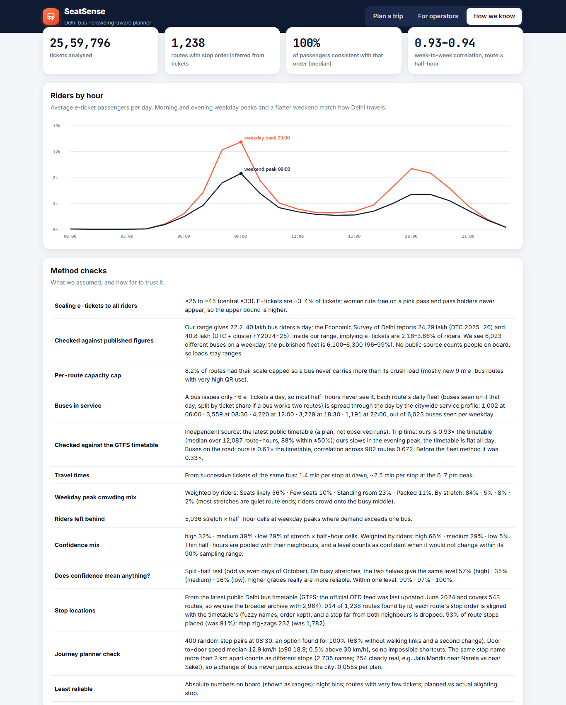

# SeatSense

**Will you get a seat on your Delhi bus?** A crowdedness-aware bus journey planner · Transport Stack Hackathon 2026 · Problem 2 · Team InnoVerse, BIT Mesra

**Live demo:** _add the Render link here after deploying_ · Try a trip directly: `/?from=Badarpur+Border+(T)&to=Saket+Metro+Station&t=08:30`

SeatSense estimates how crowded every stretch of every Delhi bus route is, every half hour, from 2.56 million October 2026 ONDC e-tickets, and shows it next to each journey option, so commuters can trade a few minutes for a seat. Operators see where buses run out of space and riders are left behind.


| For operators | How we know (validation) | On a phone |
|---|---|---|
|  |  |  |

## What it does

- **Crowding for every option:** time, crowding level, a stretch-by-stretch colour bar, people on board (as a range) and a confidence grade per leg; "Show every stop" gives arrival times and load at each stop.
- **Map:** the chosen option drawn in its crowding colours, with walks and change points.
- **Best time to leave:** trip time and crowding for departures from 30 min earlier to 90 min later, and a tip such as *"Leave at 09:00: seats instead of standing, 3 min quicker"*. A slider trades minutes for comfort.
- **Walks and up to two changes:** 400 m walking links at the start, at a change and at the end. An option is found for 100 % of 400 random stop pairs (68 % without walks and a second change).
- **Operator view:** the most overloaded routes at any half-hour on a citywide map (164 routes over capacity at 08:30 on weekdays), and each route as a stop × half-hour heatmap and a crowding map.
- **Honest numbers:** e-tickets are only ~3–4 % of riders, so the scale is a range and is capped by bus capacity. Every figure is checked in the **How we know** tab.
- **Shareable links:** every trip and tab has its own URL (`?from=…&to=…&t=…&day=…`, `#operators`, `#method`).

See [docs/TECHNICAL_NOTE.md](docs/TECHNICAL_NOTE.md) for the method, assumptions and validation, and [docs/PROPOSAL.md](docs/PROPOSAL.md) for the proposal.

## Run it

The pipeline outputs are committed, so the app runs straight after cloning (~160 MB RAM, starts in ~3 s):

```bash
pip install -r requirements.txt
uvicorn app.main:app --port 8000
# open http://localhost:8000  ·  API docs at http://localhost:8000/docs
```

With Docker:

```bash
docker build -t seatsense .
docker run -p 8000:8000 seatsense
```

**Deploy on Render (free):** New + → Blueprint → pick this repository. `render.yaml` builds the Dockerfile and checks `/api/health`.

**Tests:**

```bash
pip install -r requirements-dev.txt
pytest -q          # 18 end-to-end API tests
```

## Rebuild from the raw data

```bash
# 1. tickets (from the hackathon brief)
curl -C - -o data/raw/October-Delhi.csv.zip https://pub-091bd9e794bb4877b10b29e6df80f065.r2.dev/2026-10/October-Delhi.csv.zip
python -c "import zipfile; zipfile.ZipFile('data/raw/October-Delhi.csv.zip').extract('October-Delhi.csv','data/raw')"
# 2. crowding model and travel times (~4 min)
python pipeline/build_crowding.py
python pipeline/build_traveltime.py
# 3. stop coordinates from the public Delhi bus GTFS (~20 MB)
mkdir -p data/raw/gtfs
curl -L -o data/raw/gtfs/delhi-bus.zip https://files.mobilitydatabase.org/mdb-1262/mdb-1262-202506170152/mdb-1262-202506170152.zip
python pipeline/build_geo.py
# 4. checks (write into data/processed/summary.json, shown in the "How we know" tab)
python pipeline/validate_confidence.py   # split-half test of the confidence grades
python pipeline/validate_gtfs.py         # trip times and buses on the road vs the GTFS timetable
python pipeline/evaluate_planner.py      # trips found, walk use, door-to-door speed
python pipeline/geo_quality.py           # stops placed, long hops, map zig-zags
python pipeline/validate_external.py     # riders and fleet vs published figures
```

The app rebuilds its memory-mapped crowding arrays (`data/processed/cube/`) automatically when `segment_crowding.parquet` changes.

## API

| Endpoint | What it returns |
|---|---|
| `GET /api/plan?origin=&dest=&depart=08:30&day=weekday&comfort=1` | Up to 4 options (direct, 1 or 2 changes, walks) with time, crowding, per-stop strip with coordinates, on-board range, confidence; best-time-to-leave data and a tip |
| `GET /api/stops?q=saket` | Stop autocomplete with spelling variants and coordinates |
| `GET /api/routes?q=717` | Route autocomplete |
| `GET /api/route/{route}?day=weekday` | Stretch × half-hour load and level matrix, route shape, busiest half-hour |
| `GET /api/hotspots?day=weekday&time=08:30` | Most overloaded routes at their worst stretch, and how many routes are over capacity |
| `GET /api/validation` | All checks: stability, confidence, split-half test, GTFS comparison, planner check |
| `GET /api/health` | Routes and stops loaded |

## Repository

```
pipeline/   build_crowding.py, build_traveltime.py, build_geo.py      (model)
            validate_confidence.py, validate_gtfs.py, validate_external.py,
            evaluate_planner.py, geo_quality.py                           (checks)
            config.json                                                 (every assumption, with notes)
app/        engine.py (stops, planner, operator queries), main.py (FastAPI)
web/        index.html (planner, operator and validation views; no build step)
tests/      test_api.py
docs/       TECHNICAL_NOTE.md, PROPOSAL.md, DEMO_SCRIPT.md, img/
data/       raw/ (not committed), processed/ (pipeline outputs, committed)
Dockerfile, render.yaml
```

## Key numbers

| | |
|---|---|
| Tickets analysed | 2,559,796 |
| Routes with stop order inferred from tickets | 1,238 (median order consistency 100 %) |
| Week-to-week correlation, route × half-hour | 0.934 · 0.939 · 0.943 |
| Weekday peak mix, weighted by riders | 56 % seats likely · 10 % few seats · 23 % standing · 11 % packed |
| Stretch × half-hours over one bus's capacity (weekday peaks) | 5,936 |
| Routes over capacity at 08:30 (weekday) | 164 |
| Routes with capacity-capped scale | 8.2 % |
| Buses on the road at 08:30 (model) | 3,559 of 6,023 seen per weekday; 0.61× the GTFS timetable |
| Trip time vs GTFS timetable | 0.93× (median), 88 % within ±50 % |
| Confidence, weighted by riders | high 66 % · medium 29 % · low 5 % |
| Route stops placed on the map | 93 % (914 routes aligned with the timetable); map zig-zags 232 (was 1,782) |
| Planner, 400 random stop pairs | 100 % found (68 % without walks / second change); door-to-door median 12.9 km/h; 0.055 s per plan |
| Scale vs published figures | 22.2–40.0 lakh riders/day modelled vs 24.29 lakh (DTC 2025-26) and 40.8 lakh (DTC + cluster FY2024-25) published; 6,023 buses seen vs fleet 6,100–6,300 |

## Credits

Data: Transport Stack / IIIT Delhi (ONDC e-ticketing, October 2026). Stop coordinates and timetable check: Delhi bus GTFS via Mobility Database / Transitland (the official OTD feed, last updated June 2024, covers fewer routes). Published ridership and fleet: Economic Survey of Delhi 2025-26 as reported in the press (links in `pipeline/validate_external.py`). Map: Leaflet, © OpenStreetMap contributors. Libraries: pandas, NumPy, PyArrow, FastAPI, Uvicorn.
