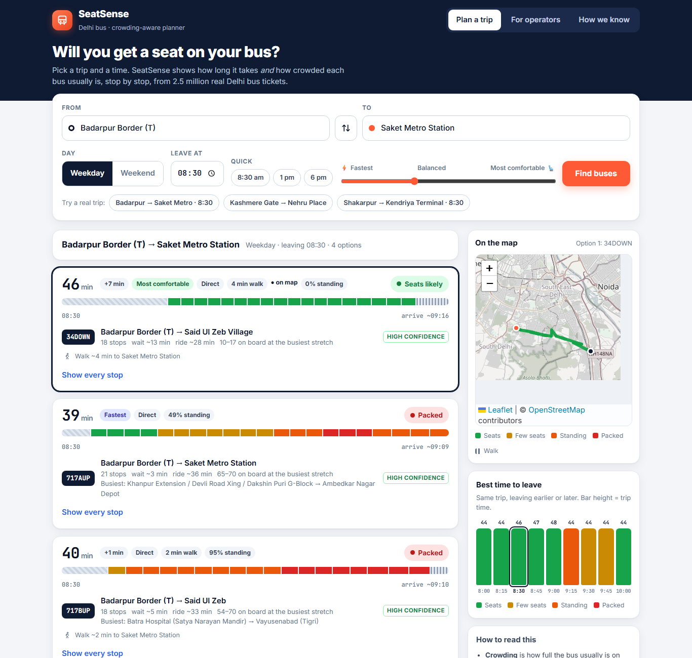
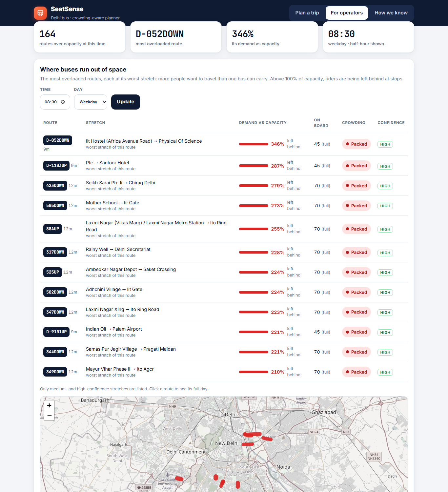
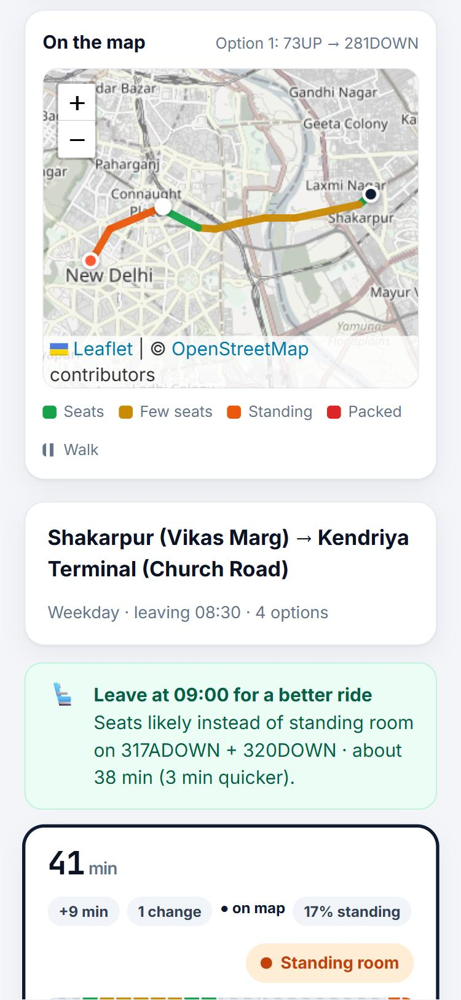
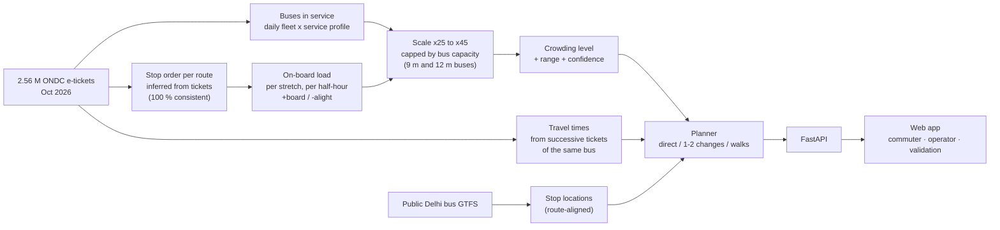

<div align="center">

# SeatSense

### Will you get a seat on your Delhi bus?

A crowdedness-aware bus journey planner for Delhi, built on 2.56 million real ONDC e-tickets.<br>
It shows **how long** each trip takes and **how crowded** each bus is, stretch by stretch, so you can trade a few minutes for a seat.

[](https://www.python.org/)
[](https://fastapi.tiangolo.com/)
[](tests/test_api.py)
[](Dockerfile)
[](#engineering)

**Transport Stack Hackathon 2026 · Problem 2 · Team InnoVerse, BIT Mesra**

**[Live demo](#live-demo)** · [Technical note (PDF)](docs/SeatSense_Technical_Note.pdf) · [Proposal (PDF)](docs/SeatSense_Proposal.pdf) · [Demo script](docs/DEMO_SCRIPT.md)

<br>



</div>

---

## The problem

Delhi's journey planners tell you **which bus** to take. They don't tell you whether you'll **get a seat**, stand for 40 minutes, or watch the bus pass by full. Operators know buses are crowded, but not **which stretch, at which half-hour**, or where riders are left behind.

## What SeatSense does

> **Badarpur Border → Saket Metro, weekday 8:30 am**
>
> | Option | Time | Crowding |
> |---|---|---|
> | 717A direct | **39 min** (fastest) | Packed, half the ride standing |
> | 34 direct | 46 min | **Seats likely** |
>
> Seven minutes buys a seat. SeatSense puts that choice in front of you.

| For commuters | For operators (DTC) |
|---|---|
| Every option with time, a stretch-by-stretch **crowding bar**, people on board (as a range) and a **confidence grade** | **164 routes over capacity** at weekday 8:30, each at its worst stretch, on a citywide map |
| **Best time to leave:** departures from 30 min earlier to 90 min later. *"Leave at 9:00: seats instead of standing, 3 min quicker"* | **Demand vs capacity:** above 100 %, riders are being left behind at stops |
| **Map** of the chosen option in its crowding colours, with walks and change points | Any route as a **stop × half-hour heatmap** and a crowding map |
| Up to **two changes** and **400 m walks**; a slider from *Fastest* to *Most comfortable* | Busiest half-hour per route, e.g. 717A at 07:00 into Saket Metro, 122 % of capacity |
| **Shareable links** for every trip: `?from=…&to=…&t=08:30` | **How we know** tab: every assumption and check, live |

<table>
<tr>
<td width="40%"></td>
<td width="40%"></td>
<td width="20%"></td>
</tr>
<tr>
<td align="center"><b>For operators</b></td>
<td align="center"><b>How we know</b></td>
<td align="center"><b>On a phone</b></td>
</tr>
</table>

---

## How it works



1. **Stop order without a timetable.** Each ticket says "start stop comes before end stop". A weighted Borda score plus an insertion local search orders the stops of 1,238 routes; the median route is 100 % consistent with its passengers.
2. **Who is on board.** Every ticket adds riders at its boarding stop and removes them at its alighting stop; a running sum gives the load on every stretch, for every half-hour, on weekdays and weekends.
3. **From e-tickets to all riders.** E-tickets are only ≈3–4 % of riders (women ride free on a pink pass, and pass holders never appear), so the load is scaled ×25 to ×45 and capped per route so that a bus never carries more than its crush load (9 m e-bus: 25 seats / 45; 12 m bus: 35 / 70).
4. **How many buses.** A bus issues only ≈6 e-tickets a day, so most half-hours never "see" it. Each route's daily fleet is spread through the day by the city's service profile.
5. **Speeds from tickets.** Successive tickets of the same bus trace it along the route: 1.4 min per stop at dawn, 2.5 at the 6–7 pm peak. Sparse hours are shrunk towards the route's own speed.
6. **Stops on a map.** Each route's stop order is aligned with the public timetable's (fuzzy names, order kept). The same name more than 2 km apart is treated as two different stops, so a change of bus never jumps across the city.
7. **Planner.** Direct, one- and two-change options with short walks; the crowding of each stretch is read at the half-hour the bus actually gets there.

Full method, assumptions and limits: **[Technical note](docs/TECHNICAL_NOTE.md)**.

## Why you can trust the numbers

Every figure below is regenerated by the pipeline and shown live in the app's **How we know** tab.

| Check | Result |
|---|---|
| Week-to-week stability (route × half-hour) | correlation **0.934 · 0.939 · 0.943** |
| Riders per day vs the Economic Survey of Delhi | modelled **22–40 lakh**; published **24.3 lakh** (DTC) to **40.8 lakh** (DTC + cluster): inside our range |
| Buses vs the published fleet | **6,023** buses seen per weekday vs a fleet of **6,100–6,300** |
| Trip time vs the public timetable | **0.93×** (median over 12,087 route-hours) |
| Do confidence grades mean anything? (odd vs even days) | busy stretches agree **57 % · 35 % · 16 %** for high · medium · low |
| Planner on 400 random stop pairs | **100 %** found; door-to-door median **12.9 km/h** (realistic for Delhi buses) |
| Stops on the map | **93 %** placed; map zig-zags cut from 1,782 to **232** |
| Crowding at weekday peaks, by riders | **56 %** seats · 10 % few seats · **23 %** standing · **11 %** packed |

**What we do not claim:** no public source counts people on board, so loads are shown as **ranges** with a confidence grade, never as exact numbers.

---

## Live demo

**Live app:** _add your Render link here_

Try these:
- `/?from=Badarpur+Border+(T)&to=Saket+Metro+Station&t=08:30`: fastest vs a seat
- `/?from=Shakarpur+(Vikas+Marg)&to=Kendriya+Terminal+(Church+Road)&t=08:30`: leave later, get a seat
- `/#operators`: where buses run out of space

> The free server sleeps when idle; the first visit can take ≈30 s to wake it.

## Run it locally

The pipeline outputs are committed, so the app runs straight after cloning (≈160 MB RAM, starts in ≈3 s).

```bash
git clone https://github.com/MG782469/SeatSense.git
cd SeatSense
pip install -r requirements.txt
uvicorn app.main:app --port 8000
```

Open <http://localhost:8000>. Interactive API docs: <http://localhost:8000/docs>.

**With Docker**

```bash
docker build -t seatsense .
docker run -p 8000:8000 seatsense
```

**Tests**

```bash
pip install -r requirements-dev.txt
pytest -q        # 18 end-to-end API tests
```

## Deploy

[](https://render.com/deploy?repo=https://github.com/MG782469/SeatSense)

The repository includes a `Dockerfile` and a Render blueprint (`render.yaml`, free plan, health check on `/api/health`). Any Docker host works: the container listens on `$PORT` (default 8000).

<details>
<summary><b>Rebuild everything from the raw data</b></summary>

```bash
# 1. tickets (from the hackathon brief)
curl -C - -o data/raw/October-Delhi.csv.zip https://pub-091bd9e794bb4877b10b29e6df80f065.r2.dev/2026-10/October-Delhi.csv.zip
python -c "import zipfile; zipfile.ZipFile('data/raw/October-Delhi.csv.zip').extract('October-Delhi.csv','data/raw')"

# 2. crowding model and travel times (~4 min)
python pipeline/build_crowding.py
python pipeline/build_traveltime.py

# 3. stop locations from the public Delhi bus GTFS (~20 MB)
mkdir -p data/raw/gtfs
curl -L -o data/raw/gtfs/delhi-bus.zip https://files.mobilitydatabase.org/mdb-1262/mdb-1262-202506170152/mdb-1262-202506170152.zip
python pipeline/build_geo.py

# 4. checks (written to data/processed/summary.json and shown in the "How we know" tab)
python pipeline/validate_confidence.py   # split-half test of the confidence grades
python pipeline/validate_gtfs.py         # trip times and buses vs the timetable
python pipeline/validate_external.py     # riders and fleet vs published figures
python pipeline/geo_quality.py           # stops placed, long hops, map zig-zags
python pipeline/evaluate_planner.py      # trips found, walks, door-to-door speed
```

Every assumption lives in [`pipeline/config.json`](pipeline/config.json). The app rebuilds its memory-mapped crowding arrays automatically when the model output changes.

</details>

<details>
<summary><b>API</b></summary>

| Endpoint | Returns |
|---|---|
| `GET /api/plan?origin=&dest=&depart=08:30&day=weekday&comfort=1` | Up to 4 options (direct, 1–2 changes, walks): time, crowding, per-stop strip with coordinates, on-board range, confidence; best-time-to-leave data and a tip |
| `GET /api/stops?q=saket` | Stop search with spelling variants and coordinates |
| `GET /api/routes?q=717` | Route search |
| `GET /api/route/{route}?day=weekday` | Stretch × half-hour load and level matrix, route shape, busiest half-hour |
| `GET /api/hotspots?day=weekday&time=08:30` | Most overloaded routes at their worst stretch, and how many routes are over capacity |
| `GET /api/validation` | Every check shown in the "How we know" tab |
| `GET /api/health` | Routes and stops loaded |

</details>

## Engineering

- **Lean:** the 2.4 M stretch × half-hour cells are packed into memory-mapped arrays, so the API runs in **≈160 MB** (a plain Python lookup needed 1.8 GB), starts in ≈3 s and plans a trip in **≈0.06 s**.
- **Simple stack:** Python, pandas, NumPy, PyArrow, FastAPI; a single HTML page with no build step; Leaflet + OpenStreetMap for maps.
- **Reproducible:** fixed seeds, deterministic stop grouping, and every number in the docs regenerated by the pipeline.
- **Tested:** 18 end-to-end API tests, including "no cross-city transfer" and "memory under 400 MB".

```
SeatSense/
├── app/          engine.py (stops, planner, operator queries) · main.py (FastAPI)
├── web/          index.html (commuter, operator and validation views)
├── pipeline/     build_crowding · build_traveltime · build_geo     (model)
│                 validate_* · evaluate_planner · geo_quality       (checks)
│                 config.json                                       (every assumption)
├── data/         processed/ (model outputs, committed) · raw/ (not committed)
├── tests/        test_api.py
├── docs/         technical note, proposal (+ PDFs), demo script, screenshots
├── Dockerfile
└── render.yaml
```

## Limits, and what's next

**Limits we state openly**
- On-board numbers are estimates from a ≈3–4 % sample: shown as ranges with a confidence grade (95 % of riders get a medium or high grade).
- The newest public bus timetable is a plan (calendar 2022–24; the official Open Transit Data feed was last updated in June 2024). We use it only for stop locations and sanity checks.
- 7 % of route stops have no map position; alighting stops are the stops printed on tickets.

**Phase 2**
- Live bus GPS for real travel times and positions.
- Metro + bus crowding from AFC taps (Problem 5) and an origin–destination matrix from the same tickets (Problem 3).
- Crowding alerts for operators, and a "notify me when my bus has seats" feature for commuters.

## Credits

- **Data:** Transport Stack / IIIT Delhi (ONDC e-ticketing, October 2026).
- **Stop locations and timetable check:** Delhi bus GTFS via the Mobility Database / Transitland archive.
- **Published ridership and fleet:** Economic Survey of Delhi 2025-26, as reported in the press (links in [`pipeline/validate_external.py`](pipeline/validate_external.py)).
- **Maps:** Leaflet, © OpenStreetMap contributors.

<div align="center">

Built by **Team InnoVerse**, BIT Mesra, for the Transport Stack Hackathon 2026.

</div>
